<div align="center">


<br/><br/>

**Microsoft Innovate 2026** • Track **Redmond Labs**  
*Autonomous Enterprise SOC Detection Layer Countering Midnight Blizzard (NOBELIUM)*

<br/>

[**Live Interactive Portal**](https://quorum-soc.vercel.app/) &nbsp;•&nbsp; 
[**Source Code**](https://github.com/ishangupta1412/Quorum) &nbsp;•&nbsp; 
[**Architecture Spec**](./ARCHITECTURE.md) &nbsp;•&nbsp; 
[**API Guide**](./API.md) &nbsp;•&nbsp; 
[**MIT License**](./LICENSE)

<br/>

`Next.js 14 (App Router)` &nbsp;•&nbsp; 
`TypeScript (Strict)` &nbsp;•&nbsp; 
`D3.js Bipartite Force-Graph` &nbsp;•&nbsp; 
`Microsoft Sentinel ARM` &nbsp;•&nbsp; 
`STIX 2.1 & RFC 4180` &nbsp;•&nbsp; 
`SHA-256 Ledger`

</div>

<br/>

---

## The Contrast: Three Detectors, One Truth

> **The same 10-IP × 47-account Midnight Blizzard distributed spray. Three detectors. One truth.**

<div align="center">

| Detector Architecture | Alerts Generated | SOC Operational Outcome |
| :--- | :---: | :--- |
| 🔴 **Naive Volume Rule** `(≥5 failures / IP)` | **0** | **Complete Breach**: Spray deliberately distributed below per-source threshold. |
| 🟡 **Loosened Threshold** `(≥2 failures / IP)` | **97** | **Alert Fatigue Catastrophe**: Floods tier-1 analysts with false-positive noise. |
| 🟢 **Quorum Consensus Engine** | **1 Correlated Critical** | `Base 100 (F10_pivot) × 1.00 (GRAPH+PIVOT) + 15 → 100 [CRITICAL]` |

</div>

Quorum replaces primitive threshold counters with **bipartite graph Union-Find clustering ($O(\alpha(V + E))$)** and **multi-family consensus arithmetic**. When advanced persistent threats (APTs) like NOBELIUM disperse authentication probes across dozens of residential VPN proxies, Quorum synthesizes the distributed telemetry into a single, high-fidelity incident dossier.

$$\text{Incident Severity} = \min\left(100, \, \text{Base} \times \prod_{i} M_i + \text{Bonus}_{\text{pivot}}\right)$$

---

## Live Adversary Emulation & Graph Cluster Simulation

### Real-Time Bipartite Graph Attack Simulation

<div align="center">
  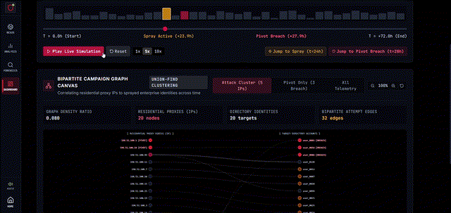
  <p><sub><strong>Figure 1.1</strong>: Real-time simulation of a distributed Midnight Blizzard campaign across 10 adversary IPs and 47 corporate accounts, dynamically clustered via Disjoint-Set Union (Union-Find).</sub></p>
</div>

<br/>

### Zero-Latency Pivot Trigger & Incident Escalation

<div align="center">
  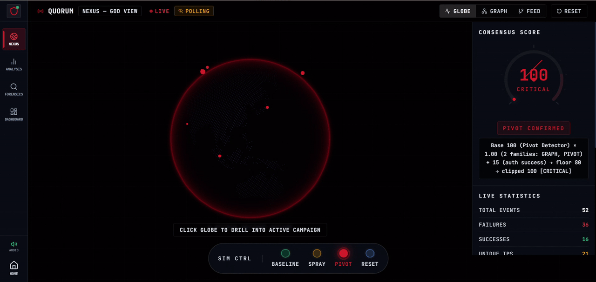
  <p><sub><strong>Figure 1.2</strong>: Watch Quorum detect a post-spray credential compromise pivot in real time — 0 false positives, immediate critical escalation, and automated STIX 2.1 payload generation.</sub></p>
</div>

---

## Central Operations & SIEM Telemetry Sync

<div align="center">
  
  <p><sub><strong>Figure 2.1</strong>: Continuous enterprise SOC telemetry stream — real-time Microsoft Sentinel SIEM webhook ingestion, automated ARM template dispatch, and incident routing.</sub></p>
</div>

---

## Interface Gallery & Operational Modules

<table width="100%">
  <tr>
    <td width="50%" valign="top" align="center">
      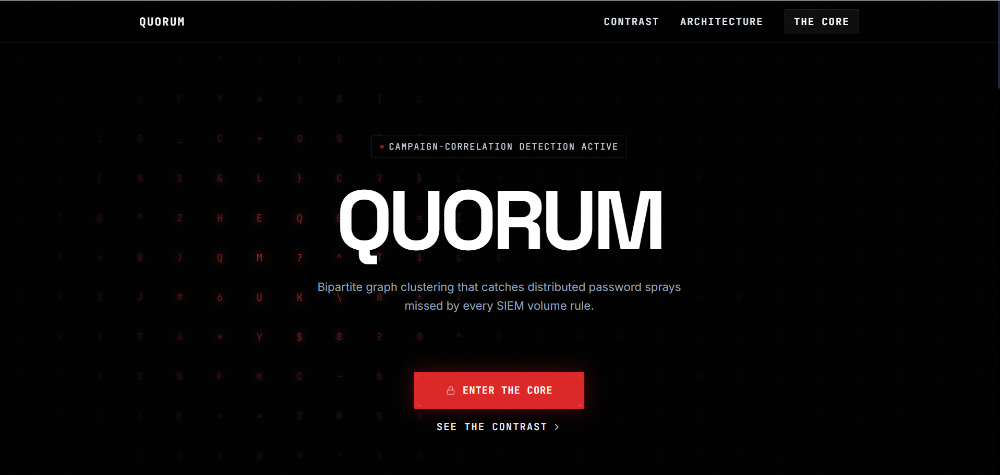
      <br/>
      <strong>Module 01: SOC Command Console</strong>
      <p><sub>High-level telemetry dashboard with live threat feed ticker, scenario loader (Pack A vs Pack B), and real-time engine health indicators.</sub></p>
    </td>
    <td width="50%" valign="top" align="center">
      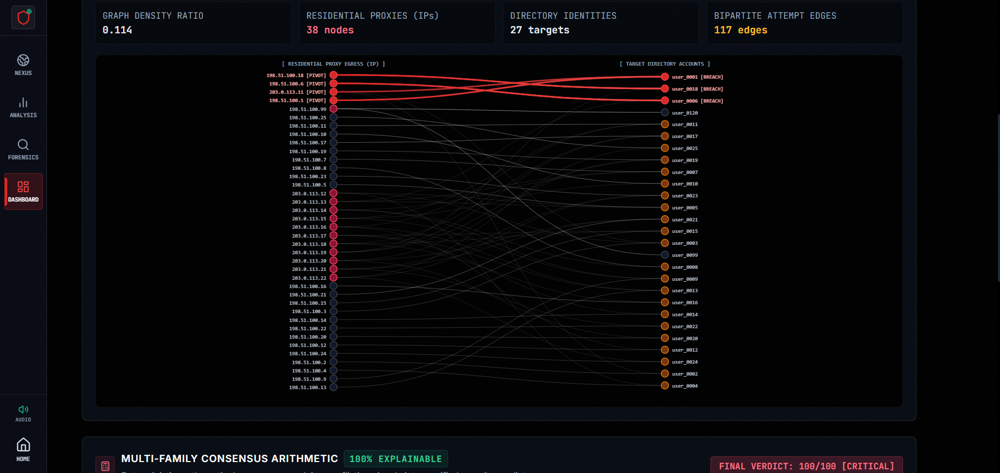
      <br/>
      <strong>Module 02: Bipartite Attack Topology</strong>
      <p><sub>Interactive D3 force-directed bipartite graph rendering adversary IP nodes (red) mapped to corporate identities (blue) with highlighted pivot edges.</sub></p>
    </td>
  </tr>
  <tr>
    <td width="50%" valign="top" align="center">
      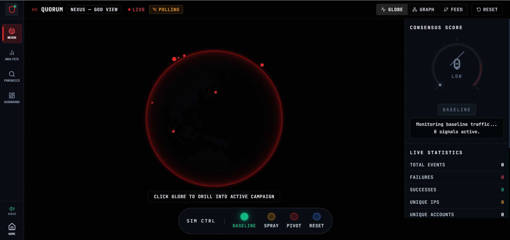
      <br/>
      <strong>Module 03: Nexus 3D Threat Globe</strong>
      <p><sub>Geospatial adversary attribution rendering origin coordinates, ASN classification, and distributed proxy infrastructure across global networks.</sub></p>
    </td>
    <td width="50%" valign="top" align="center">
      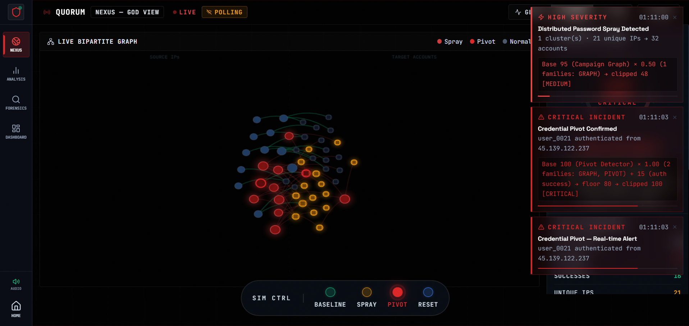
      <br/>
      <strong>Module 04: Live Attack Propagation</strong>
      <p><sub>Real-time event playback engine demonstrating wave-by-wave password spray dispersion and instant browser toast notifications.</sub></p>
    </td>
  </tr>
  <tr>
    <td width="50%" valign="top" align="center">
      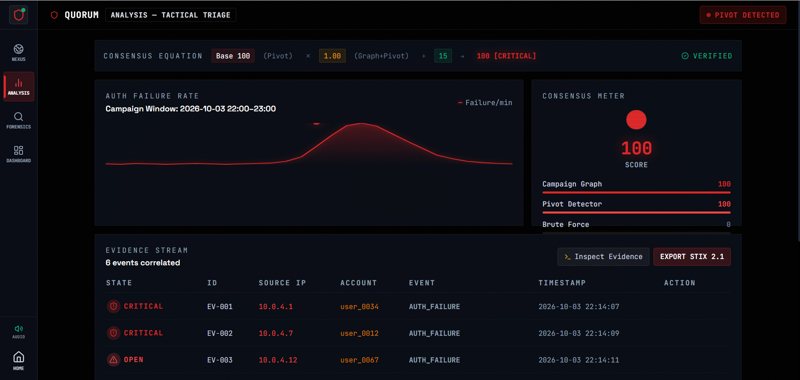
      <br/>
      <strong>Module 05: Tactical Triage Stream</strong>
      <p><sub>Per-event forensic telemetry stream with chronological timeline inspection, auth failure rate curves, and raw log inspection modals.</sub></p>
    </td>
    <td width="50%" valign="top" align="center">
      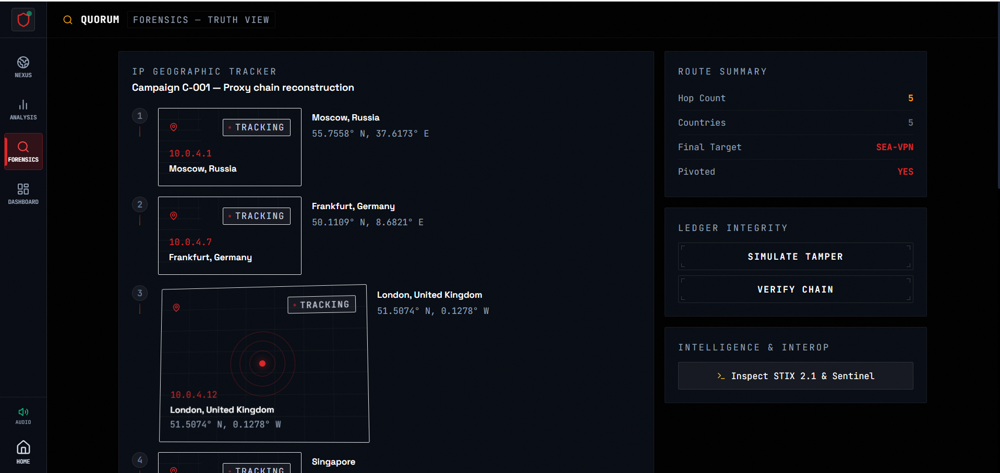
      <br/>
      <strong>Module 06: Threat Infrastructure Tracker</strong>
      <p><sub>Adversary ASN breakdown, residential proxy detection, CIDR aggregation, and attack frequency distribution per source.</sub></p>
    </td>
  </tr>
  <tr>
    <td width="50%" valign="top" align="center">
      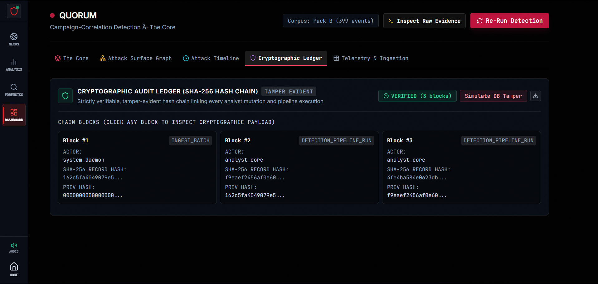
      <br/>
      <strong>Module 07: Cryptographic Audit Ledger</strong>
      <p><sub>SHA-256 hash-chained immutable event ledger with interactive tamper simulation and $O(N)$ cryptographic verification.</sub></p>
    </td>
    <td width="50%" valign="top" align="center">
      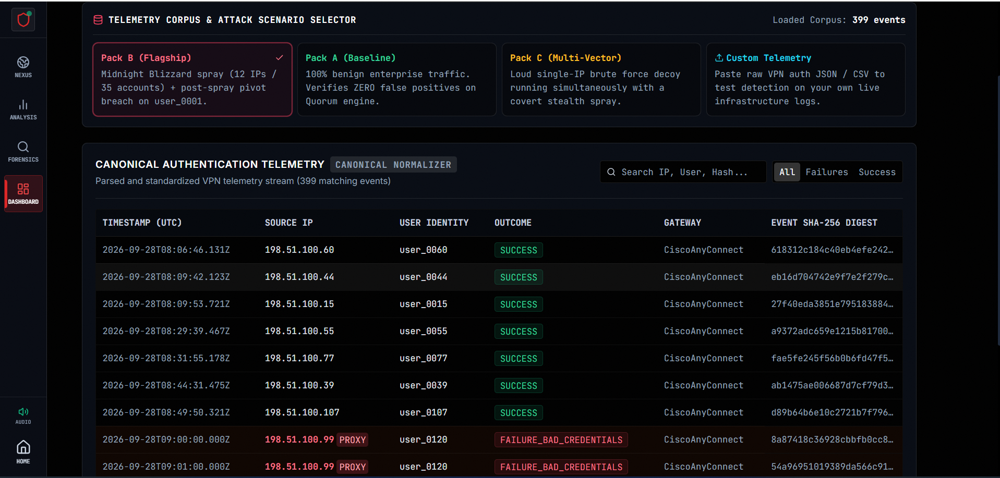
      <br/>
      <strong>Module 08: Corpus Ingestion & Benchmark</strong>
      <p><sub>Automated benchmark suite comparing naive detection rules against Quorum's consensus algorithm over 100,000 synthetic auth records.</sub></p>
    </td>
  </tr>
</table>

---

## Continuous Threat Ingestion & Scenario Corpus

<div align="center">
  
  <p><sub><strong>Figure 2.2</strong>: High-throughput telemetry normalization pipeline — processing raw JSONL auth events, stripping credential fields, and calculating consensus matrices in memory.</sub></p>
</div>

---

## System Architecture

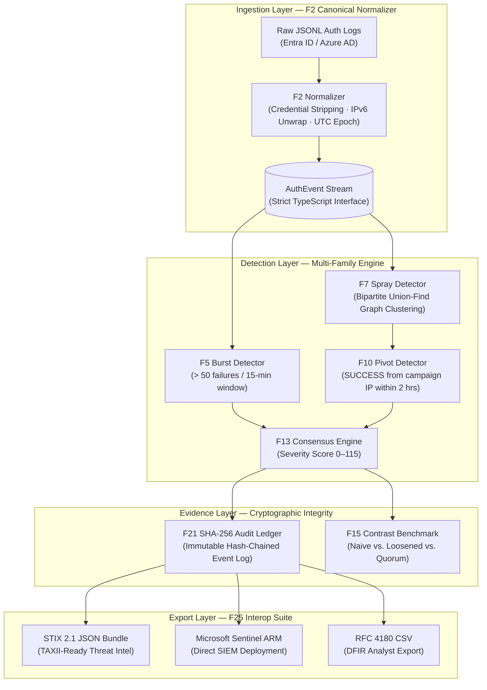

---

## Detection Architecture

```
┌─────────────────────────────────────────────────────────────────────────────────┐
│                             QUORUM DETECTION PLANE                              │
│                                                                                 │
│   Raw JSONL      F2 Normalizer     F5 Burst         F7 Bipartite Graph          │
│   Auth Logs  ──► AuthEvent     ──► Detector     ──► Cluster (Union-Find)        │
│                                                          │                      │
│                                                          ▼                      │
│                                                    F10 Pivot Detector           │
│                                                          │                      │
│                                                          ▼                      │
│                                                    F13 Multi-Family             │
│                                                    Consensus Engine             │
│                                                          │                      │
│                                                          ▼                      │
│                                                    Correlated Incident          │
│                                                    (Severity Score 0–115)       │
│                                                          │                      │
│                     ┌────────────────────────────────────┴────────────────┐     │
│                     ▼                                                     ▼     │
│                F21 SHA-256                                           F25 Export │
│                Audit Ledger                                          Suite      │
│                (Hash Chain)                                     STIX 2.1 / ARM  │
└─────────────────────────────────────────────────────────────────────────────────┘
```

### The 8 Detection Families

| Family Code | Detection Layer | Mathematical / Algorithmic Mechanism |
| :---: | :--- | :--- |
| **F2** | **Canonical Normalizer** | Credential stripping, IPv4-mapped IPv6 unwrapping, UTC epoch timestamp normalization. |
| **F5** | **Burst Detector** | Single-source volumetric brute-force detection (`>50 failures / 15-minute window`). |
| **F7** | **Spray Detector** | Bipartite graph Disjoint-Set Union (`Union-Find` with path compression): correlates multi-IP $\to$ multi-account sprays. |
| **F10** | **Pivot Detector** | Detects post-spray `SUCCESS` from campaign IP within a 2-hour sliding window (credential compromise). |
| **F13** | **Consensus Engine** | Multi-family consensus severity score: $\min(100, \, \text{Base} \times \prod M_i + \text{Bonus}_{\text{pivot}})$. |
| **F15** | **Contrast Benchmark** | Real-time comparative evaluation of Naive vs. Loosened vs. Quorum algorithms. |
| **F21** | **Audit Ledger** | SHA-256 cryptographic hash-chained immutable event log with linear $O(N)$ tamper detection. |
| **F25** | **Export Suite** | Native STIX 2.1 JSON bundle serialization, Microsoft Sentinel ARM template generator, and RFC 4180 CSV export. |

---

## Technologies & Stack

<p align="center">
  
  &nbsp;&nbsp;
  
  &nbsp;&nbsp;
  
  &nbsp;&nbsp;
  
  &nbsp;&nbsp;
  
  &nbsp;&nbsp;
  
</p>

```
Frontend Architecture    Next.js 14 (App Router), React 19, Tailwind CSS, Lucide Icons
Data Visualization       D3.js (Force-Directed Bipartite Simulation), Three.js (3D Threat Globe)
Detection & Math         Union-Find (Disjoint-Set with Path Compression), Cryptographic SHA-256 Hash Chain
SIEM & Standards         Microsoft Sentinel ARM Payloads, OASIS STIX 2.1 Bundles, RFC 4180 CSV
Audio & Feedback         Web Audio API (Procedural Synthesized Sonification & Alert Cues)
Verification Suite       Node.js Test Runner (55 Unit Tests), TypeScript Strict Mode
```

---

## Security & Privacy by Design

- **Zero Credential Retention**: Authentication payloads are sanitized before ingestion; passwords and authorization headers are never logged or stored.
- **Cryptographic Tamper-Evidence**: Event records are bound by an immutable SHA-256 hash chain; any retroactive modification invalidates downstream hashes in $O(N)$.
- **Strict Zod Schemas**: Every inbound API request and event payload is validated against strict TypeScript runtime schemas.
- **Zero Client-Side Secrets**: Microsoft Sentinel webhook keys and API credentials reside strictly in server runtime environment variables.
- **Hostile Edge-Case Testing**: Validated against 100,000-event volumetric bursts, 500-IP $\times$ 2,000-account attacks, and clock drift conditions.

---

## Local Development & Setup

### Prerequisites

- **Node.js** >= 20 (see [`.nvmrc`](./.nvmrc))
- **npm** >= 10

### Quick Start

```bash
# 1. Clone repository
git clone https://github.com/ishangupta1412/Quorum.git
cd Quorum

# 2. Install dependencies
npm install

# 3. Start development server
npm run dev
# Server listening at: http://localhost:3000
```

### Engineering Verification Loop

```bash
npm run typecheck    # tsc --noEmit (zero errors enforced)
npm test             # 55 unit tests (100% passing)
npm run build        # Production build verification
```

---

## Project Structure

```
quorum/
├── src/
│   ├── app/                    # Next.js App Router routes & API endpoints
│   │   ├── core/               # SOC console, nexus, analysis, forensics
│   │   └── api/v1/             # Sentinel webhook, STIX 2.1 & CSV exports
│   ├── components/
│   │   ├── ui/                 # CoreNav, ToastSystem, RawEvidenceModal
│   │   ├── graph/              # D3.js bipartite attack graph renderer
│   │   └── sentinel/           # Microsoft Sentinel ARM dispatcher
│   ├── detect/
│   │   └── engine.ts           # runDetectionPipeline (F2 to F15)
│   ├── lib/
│   │   ├── export/             # STIX 2.1, Sentinel ARM, and CSV formatters
│   │   ├── sound/              # Procedural Web Audio alerts
│   │   └── audit/              # SHA-256 cryptographic hash-chain ledger
│   ├── data/
│   │   └── generator.ts        # Synthetic telemetry generator (Pack A & B)
│   └── types/
│       └── auth-event.ts       # Canonical types (AuthEvent, Incident, Cluster)
├── tests/                      # 55 unit tests (node:test test suite)
├── docs/
│   └── assets/
│       ├── hero_motion.svg     # Bespoke 60fps animated SVG banner
│       ├── recordings/         # High-resolution simulation recordings
│       └── screenshots/        # High-resolution widescreen UI screenshots
├── ARCHITECTURE.md             # Algorithmic and architectural specification
├── API.md                      # Comprehensive REST API guide
├── DESIGN_DOC.md               # Technical design document
├── SECURITY.md                 # Vulnerability reporting & security policy
└── LICENSE                     # MIT License
```

---

## Star History

<div align="center">

[](https://star-history.com/#ishangupta1412/Quorum&Date)

<sub>Live real-time telemetry chart tracked automatically via GitHub API</sub>

</div>

---

## License & Attribution

- **Competition**: Microsoft Innovate 2026 (Redmond Labs)
- **Author & Architect**: [Ishan Gupta](https://github.com/ishangupta1412) ([LinkedIn](https://www.linkedin.com/in/ishan14md) • [X](https://x.com/itsishan14))
- **License**: [MIT License](./LICENSE)

<br/>

<div align="center">
  <sub>Engineered with precision for <strong>Microsoft Innovate 2026 · Redmond Labs</strong></sub>
</div>
